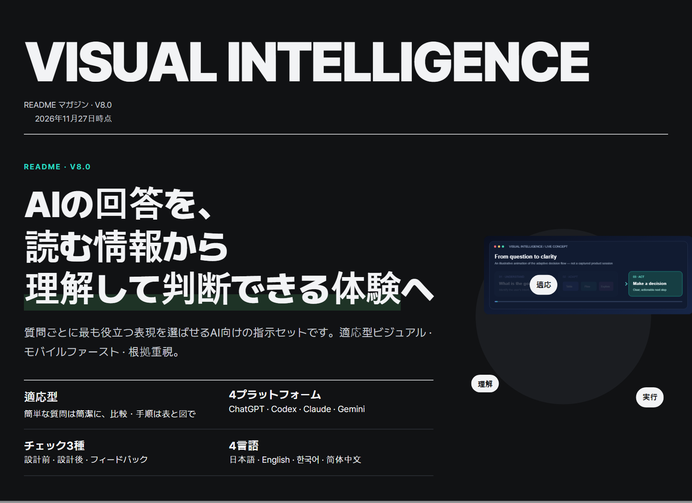
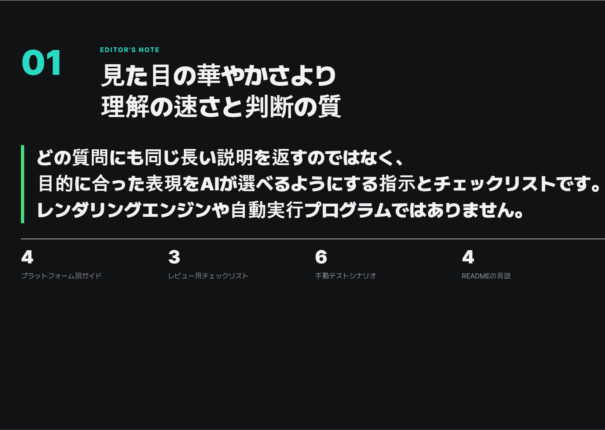
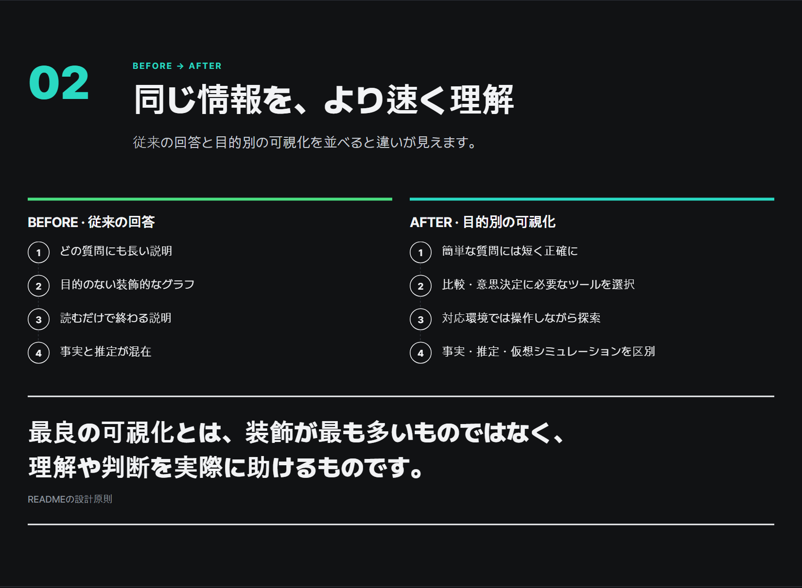
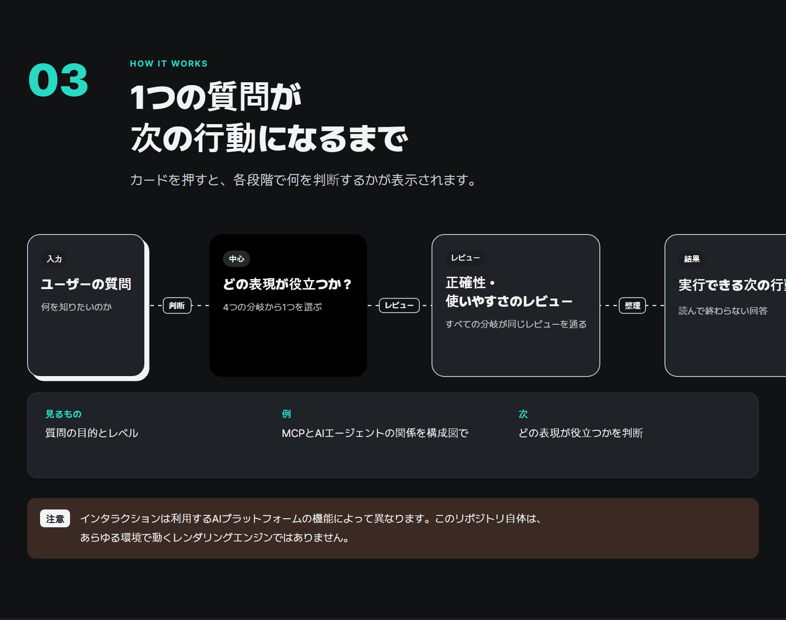
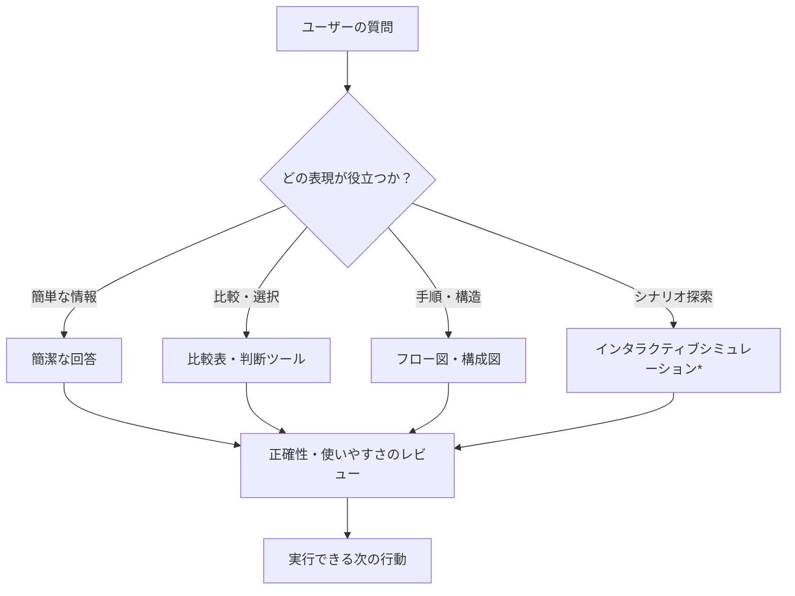
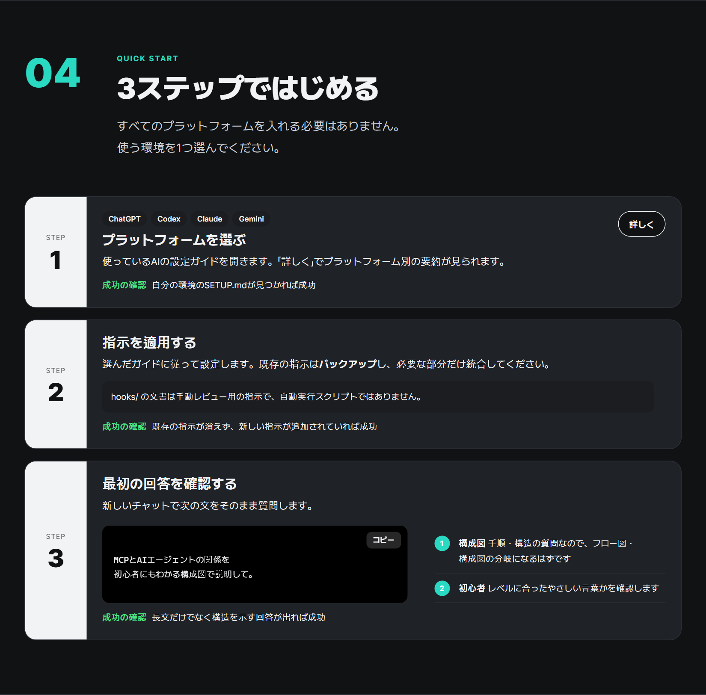
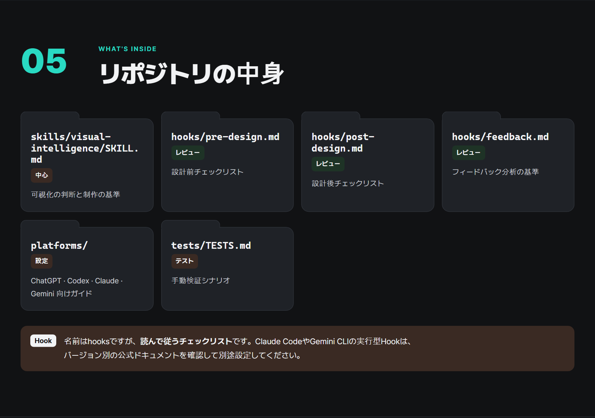
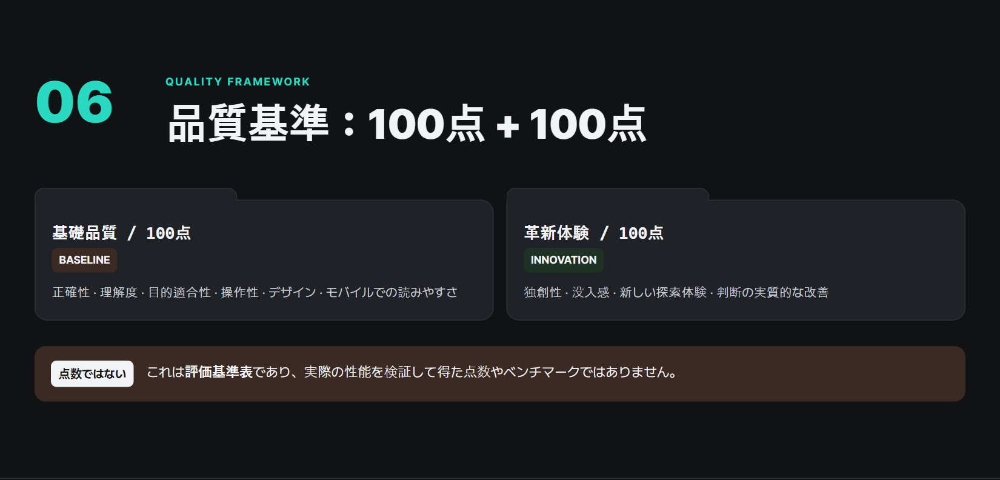
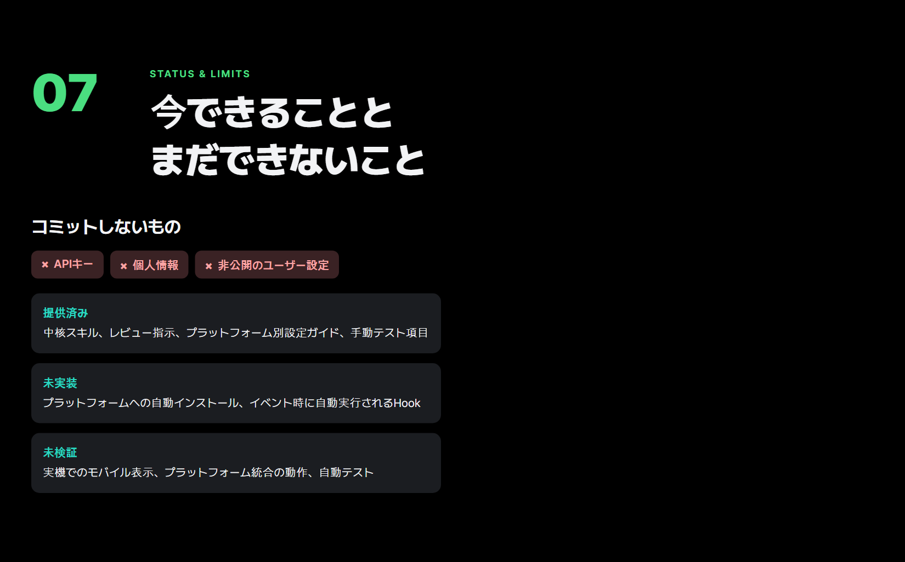
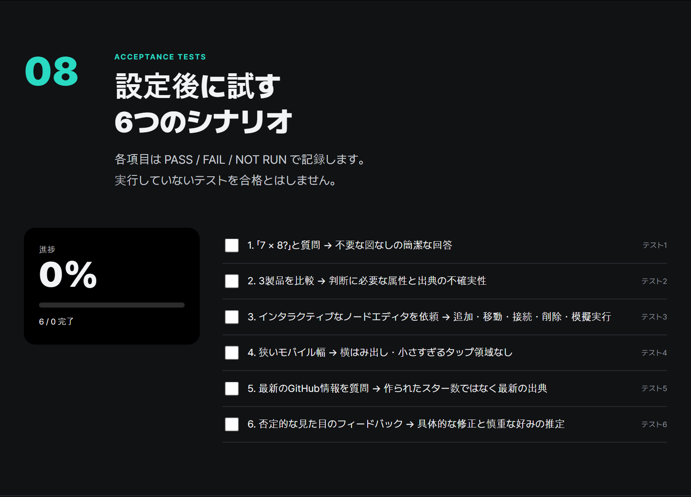

<div align="center">

[한국어](README.ko.md) · [English](README.md) · **日本語** · [简体中文](README.zh-CN.md)

<a href="https://dominkang90.github.io/visual-intelligence-v8/ja/"></a>

[**▶ めくれるマガジンで開く**](https://dominkang90.github.io/visual-intelligence-v8/ja/) · [**3分ではじめる**](#quick-start) · [**中核スキル**](skills/visual-intelligence/SKILL.md) · [**テストシナリオ**](tests/TESTS.md)

</div>

<br />







<details>
<summary>流れをテキスト（Mermaid）で見る</summary>



</details>

<a id="quick-start"></a>



| 環境 | 設定方法 |
| :--- | :--- |
| ChatGPT | [カスタム指示の設定](platforms/chatgpt/SETUP.md) |
| Codex | [スキルの設定](platforms/codex/SETUP.md) |
| Claude / Claude Code | [環境別の設定](platforms/claude/SETUP.md) |
| Gemini / Gemini CLI | [環境別の設定](platforms/gemini/SETUP.md) |

**最初の確認用の質問**

```text
MCPとAIエージェントの関係を
初心者にもわかる構成図で説明して。
```



[`skills/visual-intelligence/SKILL.md`](skills/visual-intelligence/SKILL.md) 中核スキル · [`hooks/pre-design.md`](hooks/pre-design.md) 設計前チェック · [`hooks/post-design.md`](hooks/post-design.md) 設計後チェック · [`hooks/feedback.md`](hooks/feedback.md) フィードバック分析 · [`platforms/`](platforms/) プラットフォーム別ガイド · [`tests/TESTS.md`](tests/TESTS.md) テストシナリオ







<p align="right"><a href="tests/TESTS.md"><b>テストシナリオを開く →</b></a></p>

---

<div align="center">

**リンク** · [中核スキル](skills/visual-intelligence/SKILL.md) · [設計前チェック](hooks/pre-design.md) · [設計後チェック](hooks/post-design.md) · [フィードバック](hooks/feedback.md) · [ChatGPT指示](platforms/chatgpt/GLOBAL-INSTRUCTIONS.txt) · [変更履歴](CHANGELOG.md) · [MITライセンス](LICENSE)

<sub>READMEの画像は同じ内容のマガジン画面をキャプチャしたものです。カード操作・コピー・チェックリストはマガジンで使えます。</sub>

<sub>VISUAL INTELLIGENCE V8.0 · 装飾より理解、説明より実行。</sub>

[한국어](README.ko.md) · [English](README.md) · **日本語** · [简体中文](README.zh-CN.md)

</div>
