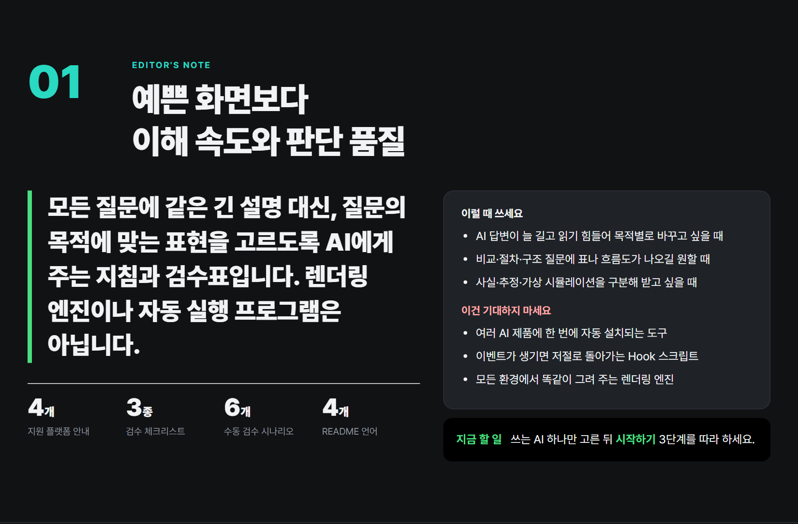
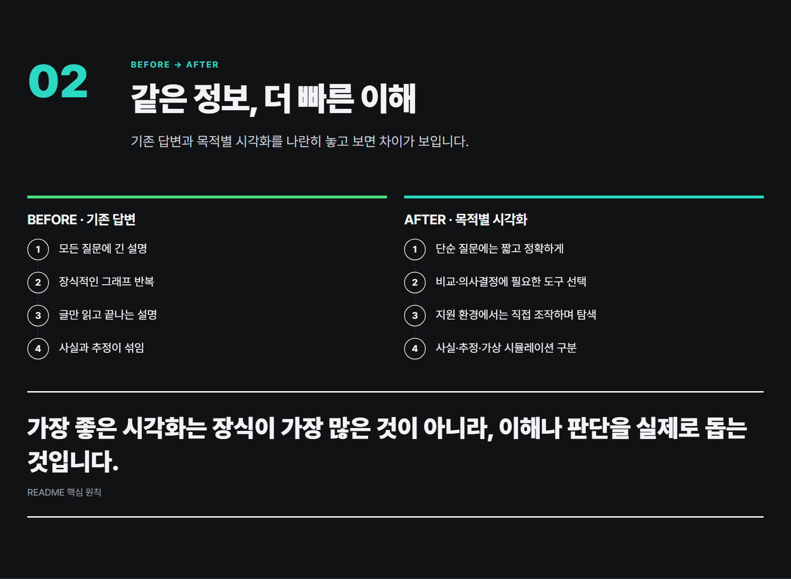
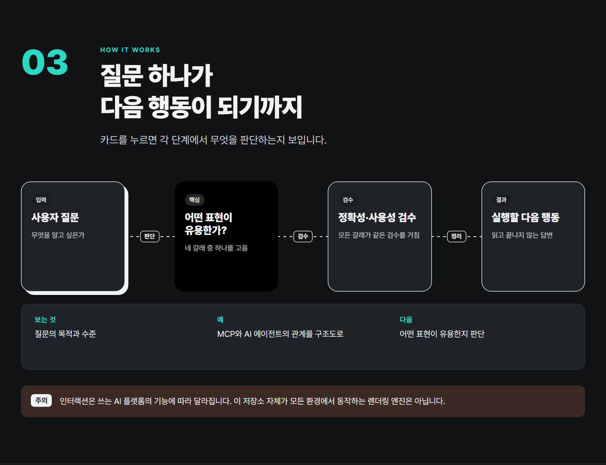
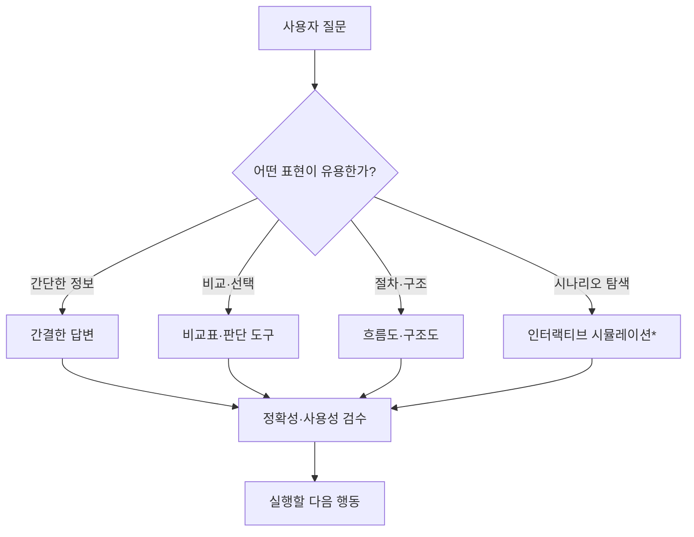
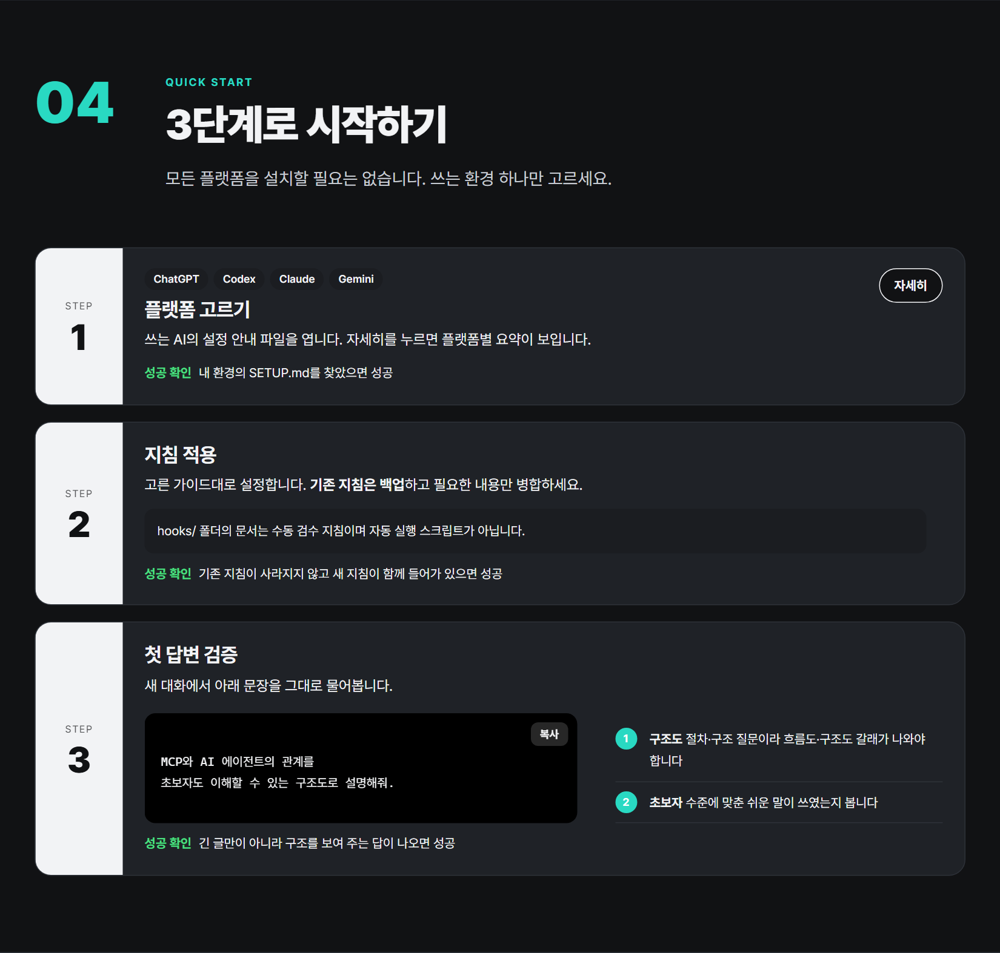
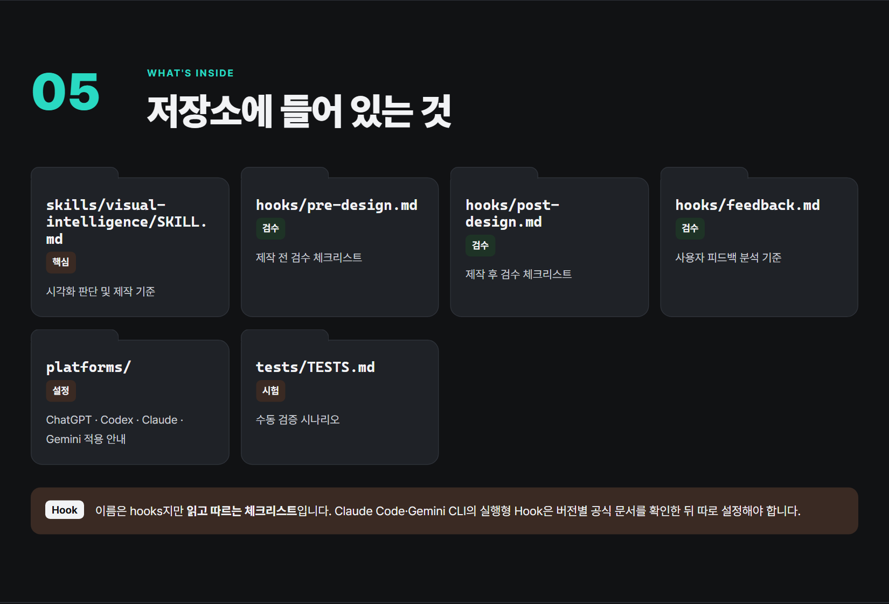
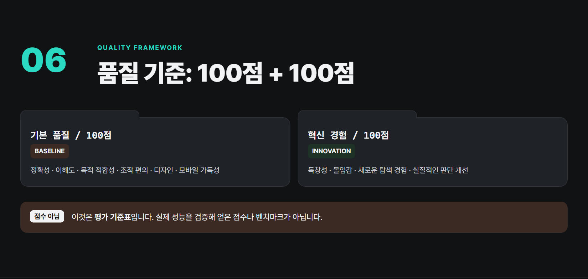
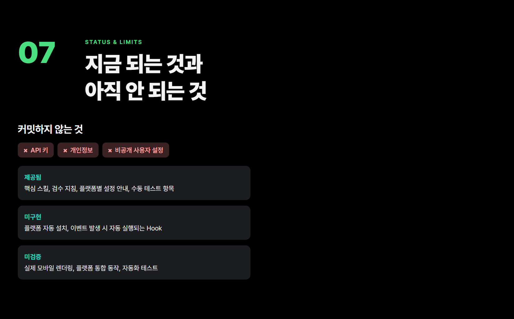
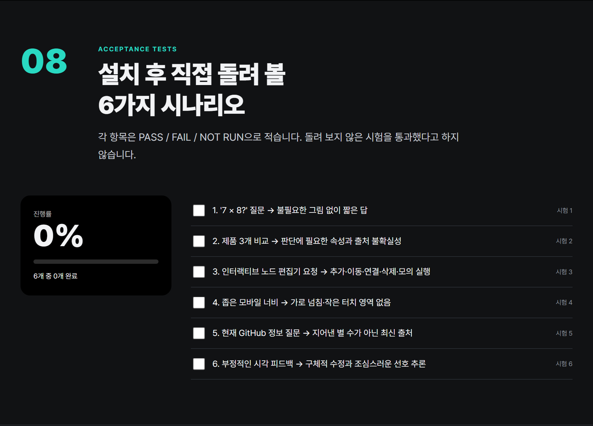

<div align="center">

**한국어** · [English](README.md) · [日本語](README.ja.md) · [简体中文](README.zh-CN.md)

<a href="https://dominkang90.github.io/visual-intelligence-v8/ko/"></a>

[**▶ 넘겨 보는 매거진으로 열기**](https://dominkang90.github.io/visual-intelligence-v8/ko/) · [**3분 시작하기**](#quick-start) · [**핵심 스킬**](skills/visual-intelligence/SKILL.md) · [**검수 시나리오**](tests/TESTS.md)

</div>

<br />







<details>
<summary>작동 흐름을 텍스트(Mermaid)로 보기</summary>



</details>

<a id="quick-start"></a>



| 환경 | 적용 방법 |
| :--- | :--- |
| ChatGPT | [맞춤 지침 설정](platforms/chatgpt/SETUP.md) |
| Codex | [스킬 설정](platforms/codex/SETUP.md) |
| Claude / Claude Code | [환경별 설정](platforms/claude/SETUP.md) |
| Gemini / Gemini CLI | [환경별 설정](platforms/gemini/SETUP.md) |

**첫 답변 검증용 질문**

```text
MCP와 AI 에이전트의 관계를
초보자도 이해할 수 있는 구조도로 설명해줘.
```



[`skills/visual-intelligence/SKILL.md`](skills/visual-intelligence/SKILL.md) 핵심 스킬 · [`hooks/pre-design.md`](hooks/pre-design.md) 제작 전 검수 · [`hooks/post-design.md`](hooks/post-design.md) 제작 후 검수 · [`hooks/feedback.md`](hooks/feedback.md) 피드백 분석 · [`platforms/`](platforms/) 플랫폼별 안내 · [`tests/TESTS.md`](tests/TESTS.md) 검수 시나리오







<p align="right"><a href="tests/TESTS.md"><b>검수 시나리오 열기 →</b></a></p>

---

<div align="center">

**바로가기** · [핵심 스킬](skills/visual-intelligence/SKILL.md) · [제작 전 검수](hooks/pre-design.md) · [제작 후 검수](hooks/post-design.md) · [피드백 분석](hooks/feedback.md) · [ChatGPT 지침](platforms/chatgpt/GLOBAL-INSTRUCTIONS.txt) · [변경 이력](CHANGELOG.md) · [MIT 라이선스](LICENSE)

<sub>README 그림은 같은 내용의 매거진 화면을 캡처한 것입니다. 상호작용(카드 누르기, 복사, 체크리스트)은 매거진에서 됩니다.</sub>

<sub>VISUAL INTELLIGENCE V8.0 · 장식보다 이해, 설명보다 실행.</sub>

**한국어** · [English](README.md) · [日本語](README.ja.md) · [简体中文](README.zh-CN.md)

</div>
