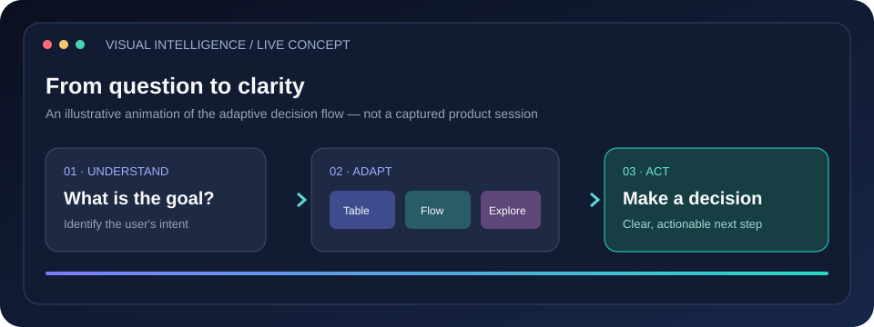
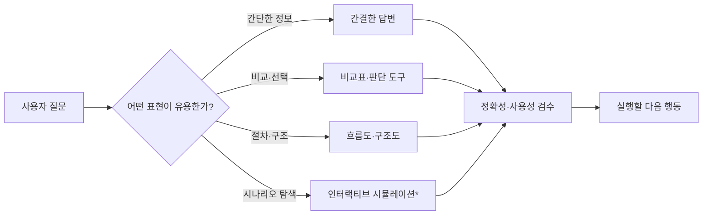

<div align="center">

# VISUAL INTELLIGENCE V8.0

### AI 답변을 읽는 정보에서 이해하고 판단하는 경험으로.

**상황 적응형 시각화 · 모바일 우선 · 근거 중심**

[**3분 시작하기**](#-3분-시작하기) · [**핵심 스킬 보기**](skills/visual-intelligence/SKILL.md) · [**검수 항목 보기**](tests/TESTS.md)

[English](README.md) · **한국어** · [日本語](README.ja.md) · [简体中文](README.zh-CN.md)

</div>

<p align="center"></p>

<p align="center"><sub>Animated concept illustration · Not a recording of a working product</sub></p>

---

## ✨ 같은 정보, 더 빠른 이해

| BEFORE — 기존 답변 | AFTER — 목적별 시각화 |
| :--- | :--- |
| 모든 질문에 긴 설명 | 단순 질문에는 짧고 정확하게 |
| 장식적인 그래프 반복 | 비교·의사결정에 필요한 도구 선택 |
| 글만 읽고 끝나는 설명 | 지원 환경에서는 직접 조작하며 탐색 |
| 사실과 추정이 섞임 | 사실·추정·가상 시뮬레이션 구분 |

> **핵심 원칙:** 예쁜 화면보다 이해 속도와 의사결정 품질을 우선합니다.

## 🧭 작동 흐름



*인터랙션은 사용하는 AI 플랫폼의 기능에 따라 달라집니다. 이 저장소 자체가 모든 환경에서 동작하는 렌더링 엔진은 아닙니다.*

## 🚀 3분 시작하기

**1. 사용하는 플랫폼을 선택하세요.**

| 플랫폼 | 설치·적용 안내 | 적용 방식 |
| :--- | :--- | :--- |
| ChatGPT | [안내 열기](platforms/chatgpt/SETUP.md) | 맞춤 지침 기반 |
| Codex | [안내 열기](platforms/codex/SETUP.md) | 코딩 작업용 스킬 지침 |
| Claude / Claude Code | [안내 열기](platforms/claude/SETUP.md) | 환경별 설정 |
| Gemini / Gemini CLI | [안내 열기](platforms/gemini/SETUP.md) | 환경별 설정 |

**2.** 안내에 따라 지침 또는 스킬을 적용합니다. **3.** [검수 시나리오](tests/TESTS.md)를 직접 실행하고 결과를 기록합니다.

## 🧩 프로젝트 구성

```text
skills/visual-intelligence/SKILL.md  → 시각화 판단 및 제작 기준
hooks/pre-design.md                 → 제작 전 검수 체크리스트
hooks/post-design.md                → 제작 후 검수 체크리스트
hooks/feedback.md                   → 사용자 피드백 분석 기준
platforms/                          → 플랫폼별 적용 안내
tests/TESTS.md                      → 수동 검증 시나리오
```

## 📐 품질 기준: 100점 + 100점

| 기본 품질 / 100점 | 혁신 경험 / 100점 |
| :--- | :--- |
| 정확성·이해도·목적 적합성·조작 편의·디자인·모바일 가독성 | 독창성·몰입감·새로운 탐색 경험·실질적인 판단 개선 |

이는 **평가 기준표**이며, 실제 성능을 검증해 획득한 점수가 아닙니다.

## 🔎 현재 구현 범위

- **제공됨:** 핵심 스킬, 검수 지침, 플랫폼별 설정 안내, 수동 테스트 항목
- **미구현:** 플랫폼 자동 설치, 이벤트 발생 시 자동 실행되는 Hook
- **미검증:** 실제 모바일 렌더링, 플랫폼 통합 동작, 자동화 테스트
- **보안:** API 키·개인정보·비공개 사용자 설정은 커밋하지 않습니다.

## 📚 바로가기

[핵심 스킬](skills/visual-intelligence/SKILL.md) · [제작 전 검수](hooks/pre-design.md) · [제작 후 검수](hooks/post-design.md) · [피드백 분석](hooks/feedback.md) · [ChatGPT 지침](platforms/chatgpt/GLOBAL-INSTRUCTIONS.txt) · [변경 이력](CHANGELOG.md) · [MIT 라이선스](LICENSE)

---

<div align="center"><sub>VISUAL INTELLIGENCE V8.0 — 장식보다 이해, 설명보다 실행.</sub></div>
