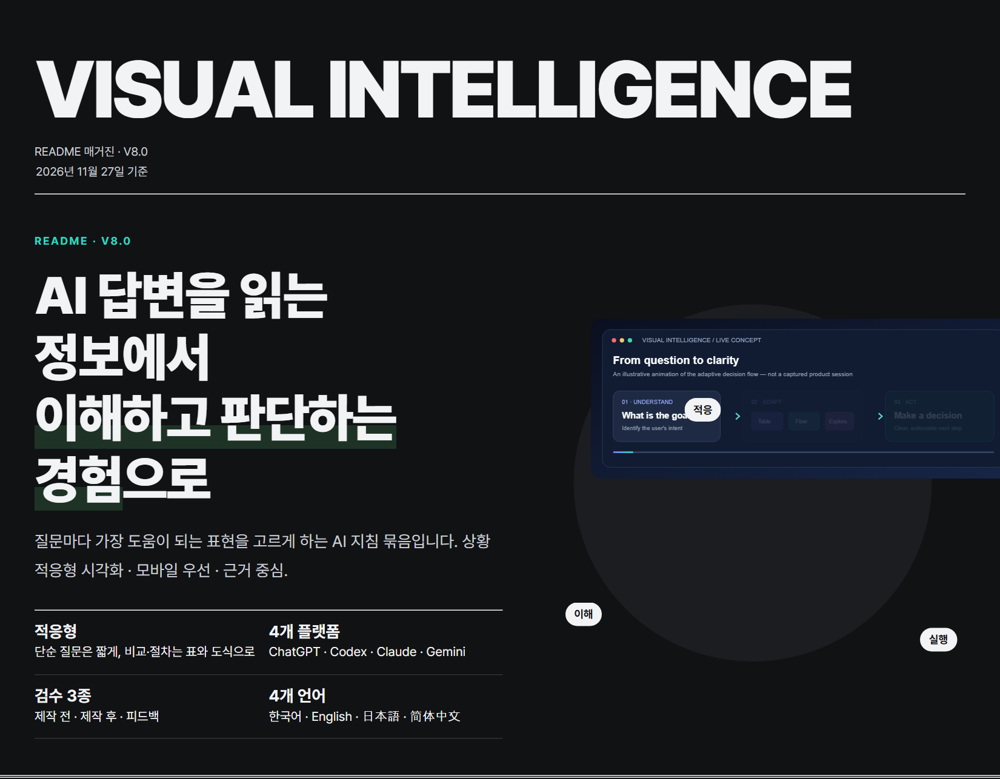
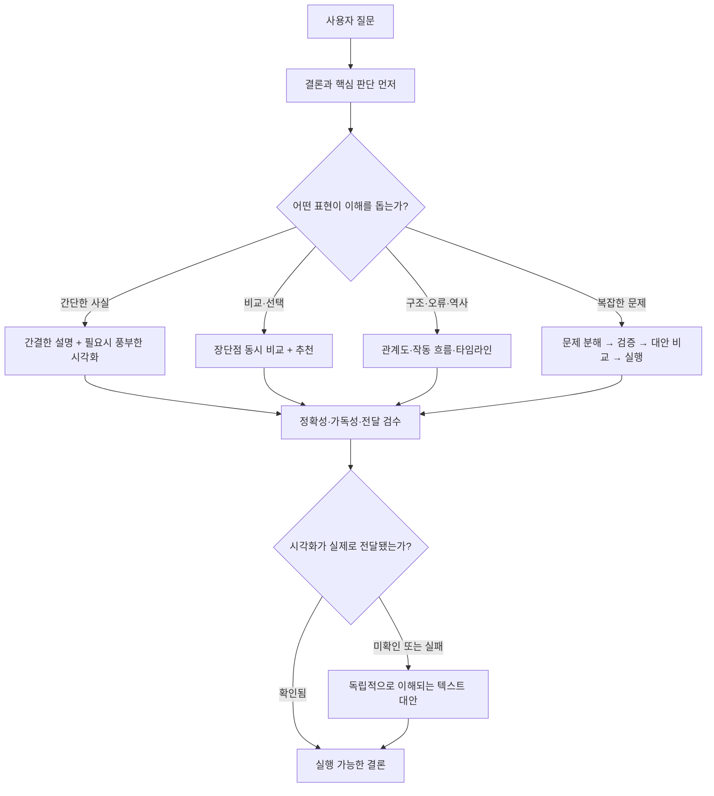

# HAEON Response OS V9 — 출시 후보

**AI 주도형 최소 개입 설치:** GitHub를 연결하거나 저장소를 읽을 수 있는 AI에 아래 문장을 전달하세요.

> https://github.com/dominkang90/visual-intelligence-v8 의 v9-ai-setup 브랜치에서 AI-SETUP.md를 읽고 내 환경에 맞게 설치·검증해줘. 직접 해야 하는 작업은 최소화해줘.

[AI 설치 프로토콜](AI-SETUP.md) · 기존 V8.1 핵심 스킬 재사용. 파일 쓰기 권한이 있는 환경에서 자동 적용을 시도하며, ChatGPT·Claude·Gemini의 설정 변경 권한이 없으면 필요한 최소 조작을 안내합니다. 실제 플랫폼별 설치 및 지속성 테스트는 아직 완료되지 않았습니다. 아래는 기존 V8.1 문서와 V8.0 시각화 예시입니다.

---

<div align="center">

**한국어** · [English](README.md) · [日本語](README.ja.md) · [简体中文](README.zh-CN.md)

# VISUAL INTELLIGENCE V8.1
**결론은 빠르게, 시각화는 풍부하게, 불필요한 복잡성은 줄이기**

<a href="https://dominkang90.github.io/visual-intelligence-v8/ko/"></a>

[**▶ 기존 V8.0 매거진 예시 열기**](https://dominkang90.github.io/visual-intelligence-v8/ko/) · [**V8.1 핵심 변화**](#v81-핵심-변화) · [**시작하기**](#quick-start) · [**핵심 스킬**](skills/visual-intelligence/SKILL.md)

</div>

> **업데이트 범위:** V8.1은 답변 설계 지침과 검토 프로토콜을 개선한 버전입니다. 기존 README 이미지와 연결된 매거진은 **V8.0 예시**이며, V8.1 화면으로 새로 구현하거나 검증한 것은 아닙니다.

## V8.1 핵심 변화

2026년 11월 27일 대화에서 확인한 방향은 **이전 답변의 속도·명료함·전달 안정성**과 **현재 답변의 구조도·비교·시뮬레이션·심층 분석**을 결합하는 것입니다. 대화 중 언급한 40:60은 설계 방향을 설명하는 비유이지 고정 비율이나 측정 결과가 아닙니다.

| 이전 방식에서 유지 | V8.1에서 강화 | 줄여야 할 문제 |
| --- | --- | --- |
| 결론을 먼저 제시 | 상황별 매거진·공간형 시각화 | 답변 전에 긴 배경 설명 |
| 화면 없이도 이해되는 설명 | 연결 관계·오류 지점의 구조도 | 시각화가 보이지 않으면 이해 불가 |
| 빠르고 간결한 판단 | 같은 상황의 장점·단점 동시 비교 | 장식용 인터랙션·반복 질문 |
| 바로 실행 가능한 조언 | 근거·반론·대안·실행 단계 | 가상 성능을 실제 검증처럼 표현 |

### 질문에 따라 자동 전환하는 답변 구조



### 오늘 개선한 세 가지 시각화 패턴

1. **호환성 원인 구조도:** 모델·IDE·운영체제·실행 환경·MCP·스킬의 연결 위치를 보여주고, 문제가 발생한 지점과 원인·해결책을 함께 제시합니다. 실제 호환 여부는 버전과 환경을 검증해야 합니다.
2. **맥락형 장단점 비교:** 복잡한 앱 개발과 작은 버그 수정처럼 사용 상황에 따라 장점과 부담을 동시에 비교합니다.
3. **설치 전후 작업 흐름 비교:** 어떤 단계가 줄거나 늘어나는지 시각화하고 이유를 설명합니다. 예시 시간·점수는 **가상 시뮬레이션**으로 표시하며 실측치로 오해하게 하지 않습니다.

### 전달 품질과 자기검토 원칙

- **결론 우선:** 복잡한 시각화보다 먼저 핵심 답변을 제공합니다.
- **표시 여부를 단정하지 않기:** 사용자가 화면을 보았는지 확인되지 않았다면 보였다고 주장하지 않습니다. 표시 실패 시 텍스트만으로도 완결되는 설명을 제공합니다.
- **사실과 추정 구분:** 검증된 사실·추론·가상 수치를 명확히 나눕니다.
- **선택적 개선 제안:** 중요한 오류는 바로 수정하고, 실제 도움이 될 때만 구체적인 고도화 방안을 제안합니다. 형식적인 후속 질문은 생략합니다.
- **모바일 우선:** 읽기 쉬운 글자, 명확한 정보 위계, 충분한 터치 영역, 불필요한 조작 최소화를 적용합니다.

## 기존 V8.0 시각화 예시 (이미지 변경 없음)


<a id="quick-start"></a>
## 시작하기

| 환경 | 적용 방법 |
| :--- | :--- |
| ChatGPT | [맞춤 지침 설정](platforms/chatgpt/SETUP.md) |
| Codex | [스킬 설정](platforms/codex/SETUP.md) |
| Claude / Claude Code | [환경별 설정](platforms/claude/SETUP.md) |
| Gemini / Gemini CLI | [환경별 설정](platforms/gemini/SETUP.md) |

**V8.1 검증용 질문 예시**

```text
1. 임진왜란을 누가 시작했는지 먼저 결론으로 설명하고,
   관계도나 타임라인을 제시해줘. 화면이 안 보이면 텍스트로도 설명해줘.
2. 특정 AI 스킬을 복잡한 앱 개발과 간단한 버그 수정에
   각각 적용할 때 장단점을 비교해줘. 실제 검증과 가상 예시를 구분해줘.
3. MCP와 AI 에이전트의 연결 구조를 설명하고,
   시각화가 보이지 않아도 이해 가능한 대안을 제공해줘.
```

## 저장소 구성과 검증 범위

[핵심 스킬](skills/visual-intelligence/SKILL.md) · [제작 전 검수](hooks/pre-design.md) · [제작 후 검수](hooks/post-design.md) · [피드백 분석](hooks/feedback.md) · [검수 시나리오](tests/TESTS.md) · [변경 이력](CHANGELOG.md)

**품질 평가 체계:** 기본 품질 100점(정확성·이해 속도·목적 적합성·인터랙션·디자인·모바일) + 혁신 경험 100점(놀라움·독창성·몰입·새 기능). 이는 **평가 기준**이며 실제 달성 점수나 성능 측정 결과를 뜻하지 않습니다.

**현재 구현 범위:** 스킬 지침과 검토 문서를 업데이트했습니다. 웹 UI 재구현, 자동 실행 훅, 실제 화면 표시 검증, 종단 간 자동 테스트 완료를 주장하지 않습니다. 기존 V8.0 이미지도 변경하지 않았습니다.

---

<div align="center"><sub>VISUAL INTELLIGENCE V8.1 · 빠른 결론, 필요한 만큼의 깊이, 확실한 전달.</sub></div>
