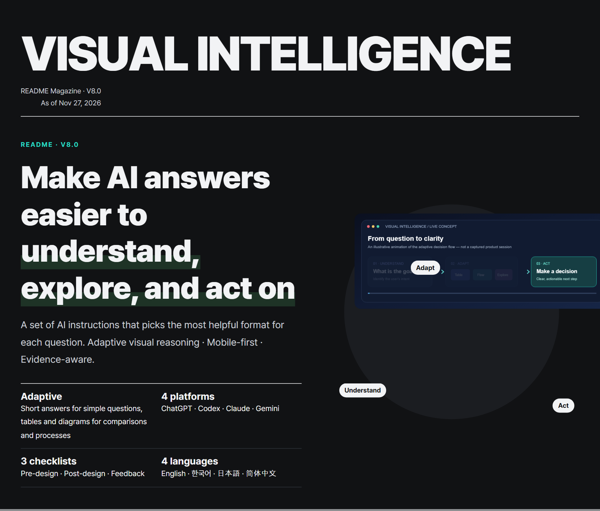
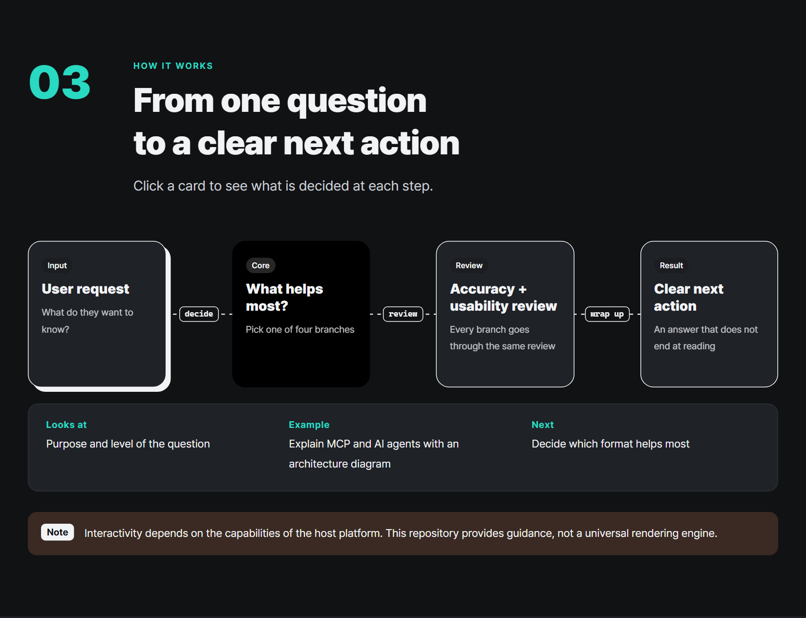
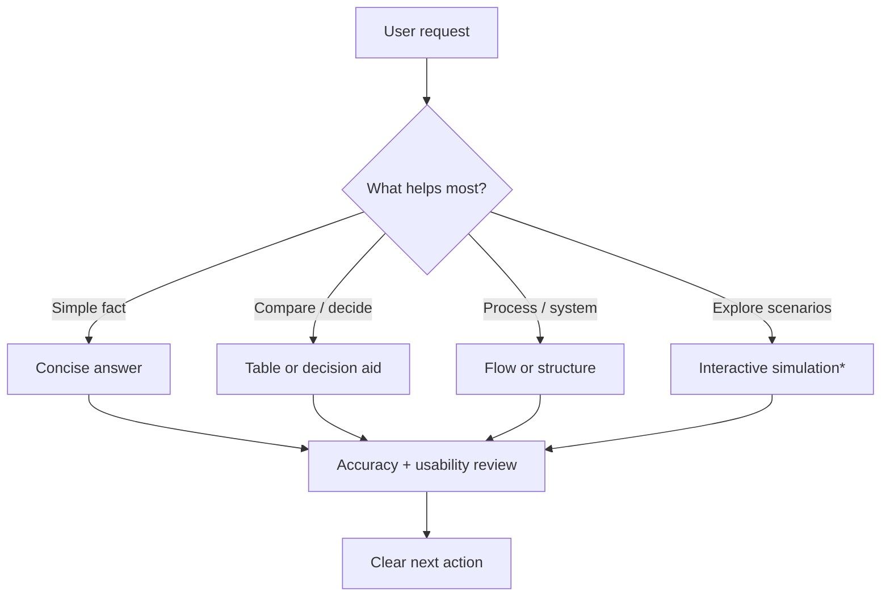
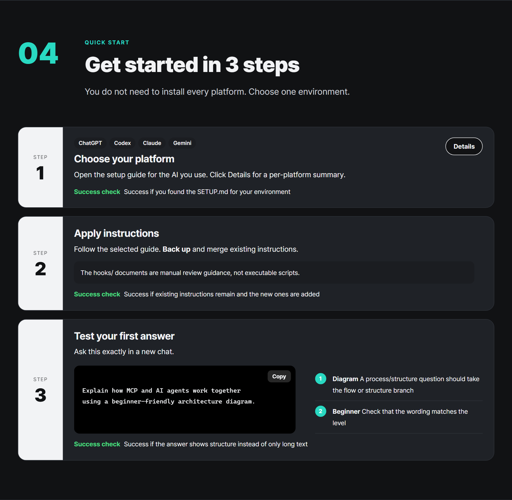
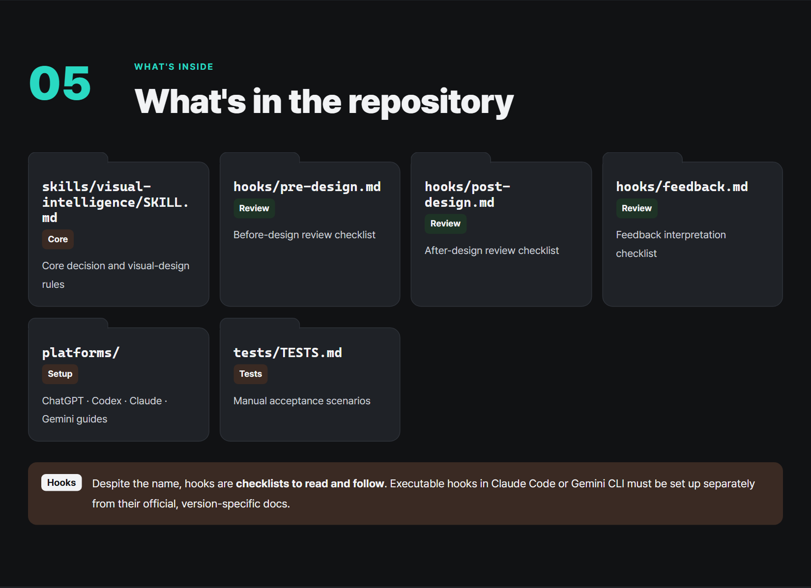
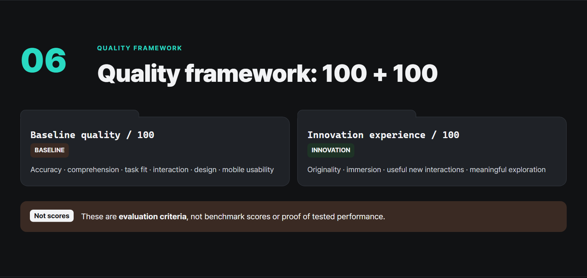
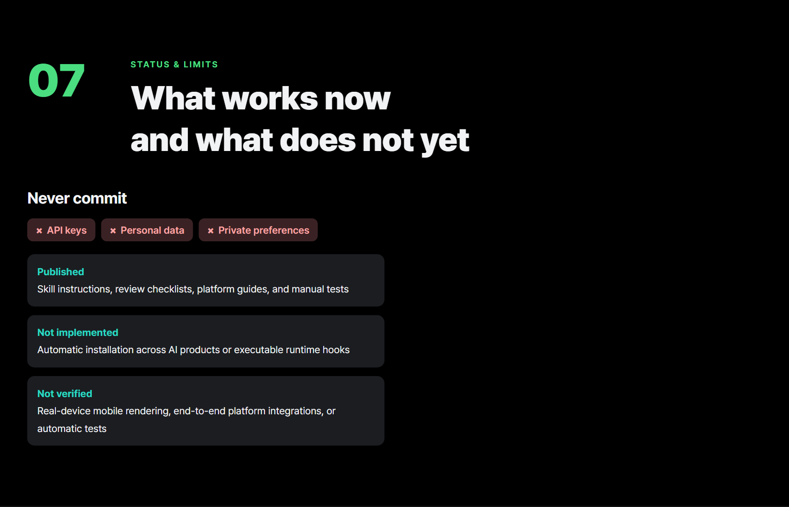
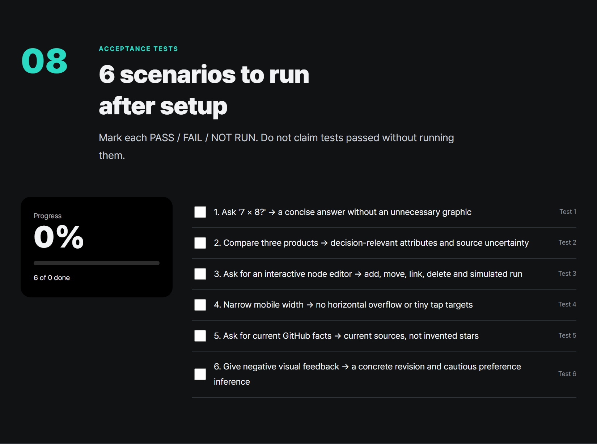

<div align="center">

[한국어](README.ko.md) · **English** · [日本語](README.ja.md) · [简体中文](README.zh-CN.md)

<a href="https://dominkang90.github.io/visual-intelligence-v8/en/"></a>

[**▶ Open as a swipeable magazine**](https://dominkang90.github.io/visual-intelligence-v8/en/) · [**Get started**](#quick-start) · [**Explore the skill**](skills/visual-intelligence/SKILL.md) · [**Run acceptance checks**](tests/TESTS.md)

</div>

<br />




<details>
<summary>View the flow as text (Mermaid)</summary>



</details>

<a id="quick-start"></a>



| Environment | Setup |
| :--- | :--- |
| ChatGPT | [Custom instructions](platforms/chatgpt/SETUP.md) |
| Codex | [Skill setup](platforms/codex/SETUP.md) |
| Claude / Claude Code | [Setup guide](platforms/claude/SETUP.md) |
| Gemini / Gemini CLI | [Setup guide](platforms/gemini/SETUP.md) |

**First test prompt**

```text
Explain how MCP and AI agents work together
using a beginner-friendly architecture diagram.
```



[`skills/visual-intelligence/SKILL.md`](skills/visual-intelligence/SKILL.md) Core skill · [`hooks/pre-design.md`](hooks/pre-design.md) Pre-design review · [`hooks/post-design.md`](hooks/post-design.md) Post-design review · [`hooks/feedback.md`](hooks/feedback.md) Feedback review · [`platforms/`](platforms/) Platform guides · [`tests/TESTS.md`](tests/TESTS.md) Acceptance scenarios







<p align="right"><a href="tests/TESTS.md"><b>Open acceptance scenarios →</b></a></p>

---

<div align="center">

**Documentation** · [Core skill](skills/visual-intelligence/SKILL.md) · [Pre-design](hooks/pre-design.md) · [Post-design](hooks/post-design.md) · [Feedback](hooks/feedback.md) · [ChatGPT instructions](platforms/chatgpt/GLOBAL-INSTRUCTIONS.txt) · [Changelog](CHANGELOG.md) · [MIT license](LICENSE)

<sub>README images are captures of the magazine with the same content. Interactions (cards, copy, checklist) work in the magazine.</sub>

<sub>VISUAL INTELLIGENCE V8.0 · Clarity first. Interaction when it matters.</sub>

[한국어](README.ko.md) · **English** · [日本語](README.ja.md) · [简体中文](README.zh-CN.md)

</div>
