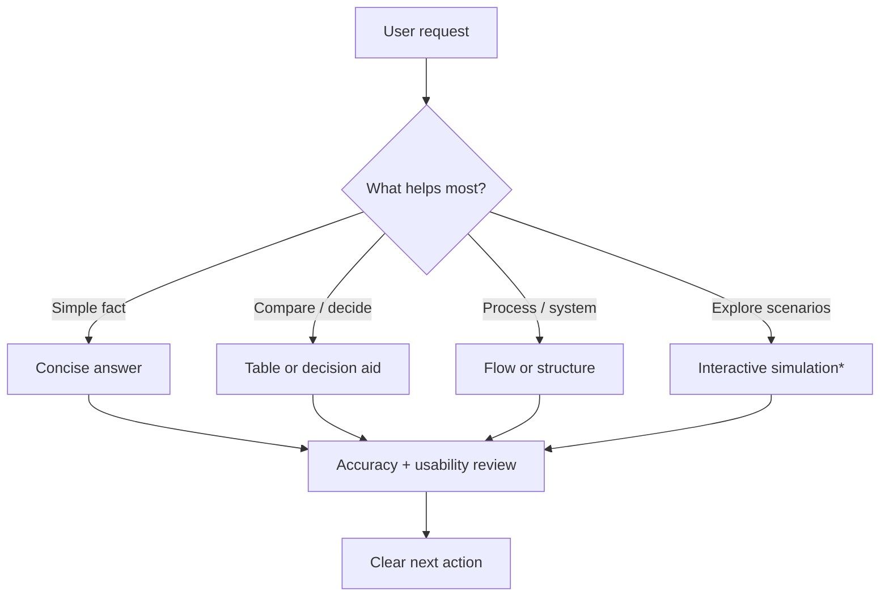

<div align="center">

# VISUAL INTELLIGENCE V8.0

### Make AI answers easier to understand, explore, and act on.

**Adaptive visual reasoning · Mobile-first · Evidence-aware**

[**Get started**](#-01--quick-start) · [**Explore the skill**](skills/visual-intelligence/SKILL.md) · [**Run acceptance checks**](tests/TESTS.md)

**English** · [한국어](README.ko.md) · [日本語](README.ja.md) · [简体中文](README.zh-CN.md)

</div>

<p align="center"></p>

<p align="center"><sub>Animated GIF concept demo · Not a recording of a working product</sub></p>

---

## 🚀 01 · Quick start

> [!TIP]
> Choose one environment. You do not need to install every platform.

### STEP 1 — Choose your platform

| Environment | Setup |
| :--- | :--- |
| ChatGPT | [Custom instructions](platforms/chatgpt/SETUP.md) |
| Codex | [Skill setup](platforms/codex/SETUP.md) |
| Claude / Claude Code | [Setup guide](platforms/claude/SETUP.md) |
| Gemini / Gemini CLI | [Setup guide](platforms/gemini/SETUP.md) |

### STEP 2 — Apply instructions

Follow the selected guide. Back up and merge existing instructions. Hook documents are manual review guidance, not executable scripts.

### STEP 3 — Test your first answer

```text
Explain how MCP and AI agents work together
using a beginner-friendly architecture diagram.
```

[Open acceptance scenarios →](tests/TESTS.md)


## ✨ 02 · From text overload to decision-ready answers

| BEFORE — one-size-fits-all | AFTER — task-adaptive |
| :--- | :--- |
| Long paragraphs for every question | Short answers for simple questions |
| Decorative charts without a purpose | Comparisons, flows, and diagrams when useful |
| Static explanation only | Interactive exploration when the platform supports it |
| Unclear sources or fabricated confidence | Facts, assumptions, and simulations clearly separated |

> **Design principle:** The best visualization is the one that improves understanding or decisions—not the one with the most decoration.

## 🧭 03 · How it works



*Interactivity depends on the capabilities of the host platform; this repository provides guidance, not a universal rendering engine.*


## 🧩 What's inside?

```text
skills/visual-intelligence/SKILL.md   → Core decision and visual-design rules
hooks/pre-design.md                   → Before-design review checklist
hooks/post-design.md                  → After-design review checklist
hooks/feedback.md                     → Feedback interpretation checklist
platforms/                            → ChatGPT, Codex, Claude, Gemini guides
tests/TESTS.md                        → Manual acceptance scenarios
```

## 📐 Quality framework: 100 + 100

| Baseline quality / 100 | Innovation experience / 100 |
| :--- | :--- |
| Accuracy, comprehension, task fit, interaction, design, mobile usability | Originality, immersion, useful new interactions, meaningful exploration |

These are **evaluation criteria**, not benchmark scores or proof of tested performance.

## 🔎 Status and limitations

- **Published:** skill instructions, review checklists, platform guides, and manual tests.
- **Not implemented here:** automatic installation across AI products or executable runtime hooks.
- **Not verified:** real-device mobile rendering, end-to-end platform integrations, or automatic tests.
- **Security:** never commit API keys, personal data, or private preferences.

## 📚 Documentation

[Core skill](skills/visual-intelligence/SKILL.md) · [Pre-design](hooks/pre-design.md) · [Post-design](hooks/post-design.md) · [Feedback](hooks/feedback.md) · [ChatGPT instructions](platforms/chatgpt/GLOBAL-INSTRUCTIONS.txt) · [Changelog](CHANGELOG.md) · [MIT license](LICENSE)

---

<div align="center"><sub>VISUAL INTELLIGENCE V8.0 — Clarity first. Interaction when it matters.</sub></div>
