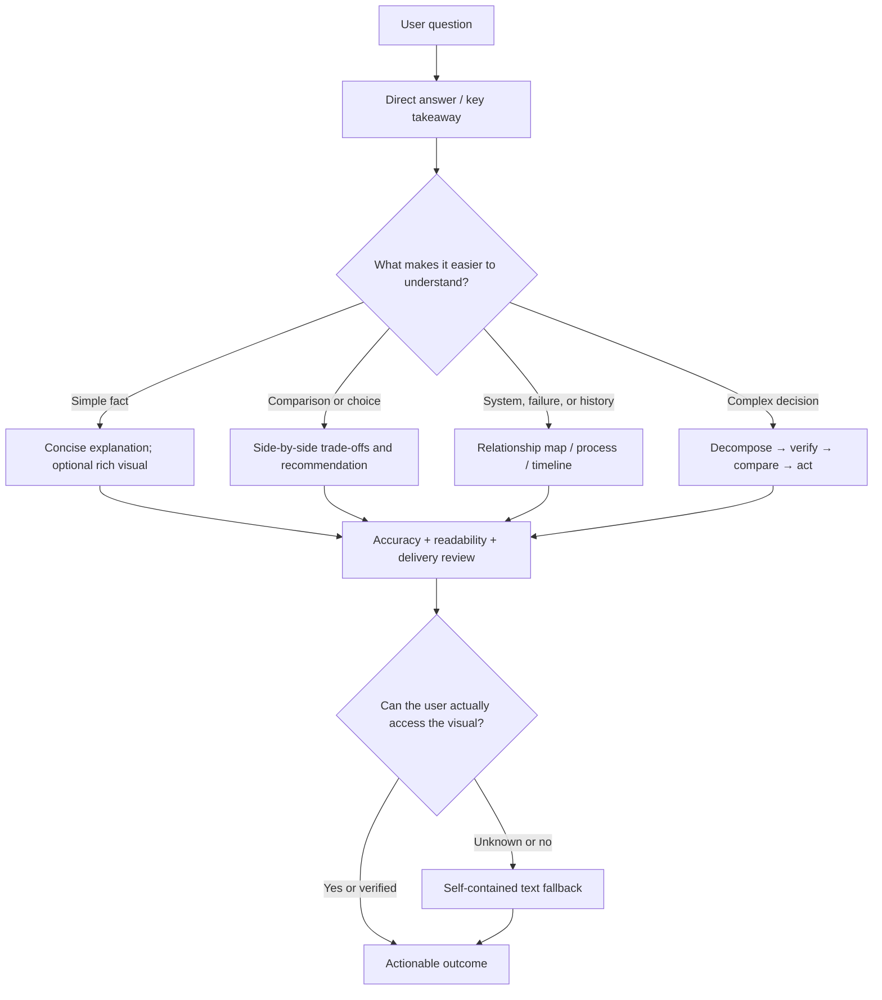
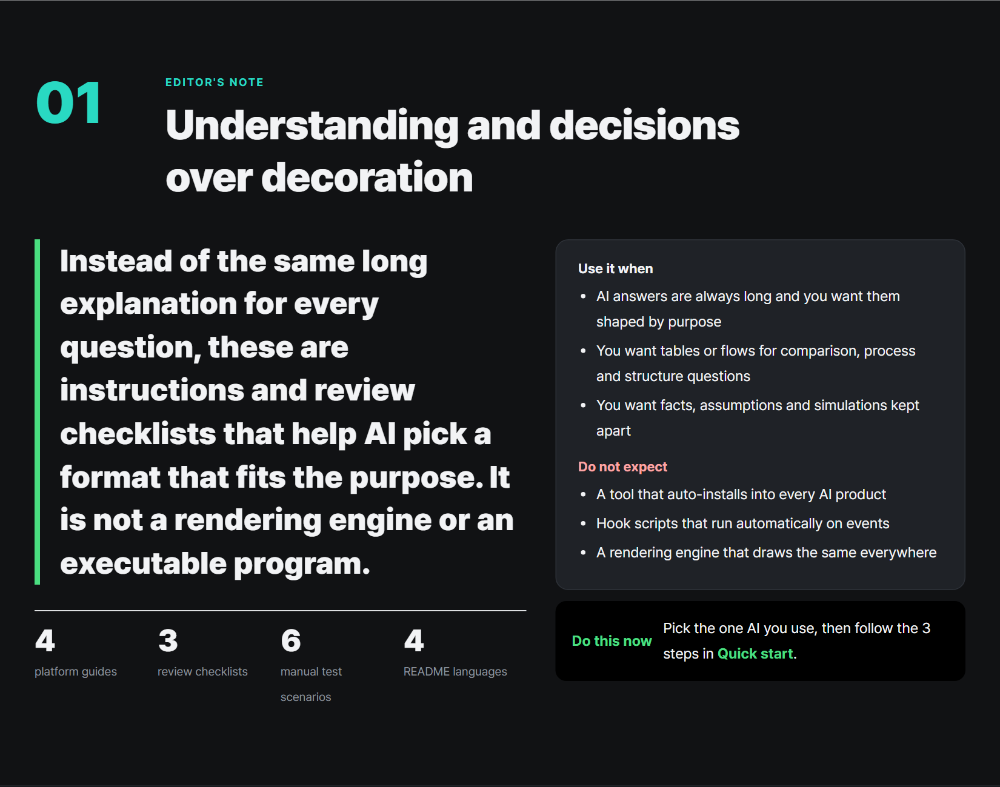
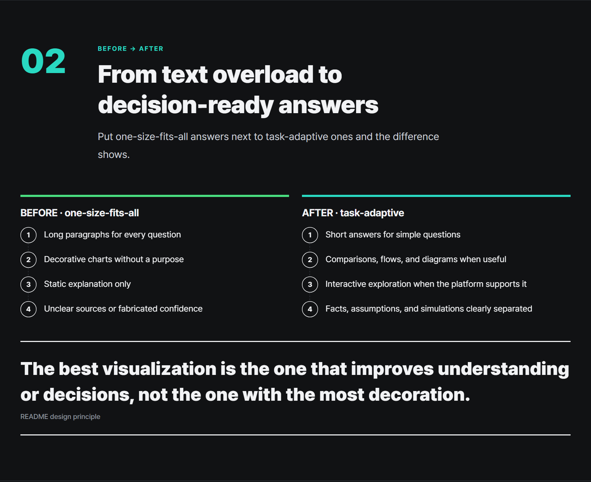

# HAEON Response OS V9 — release candidate

**AI-led minimal-touch setup:** give your AI this request:

> Read AI-SETUP.md on the v9-ai-setup branch of https://github.com/dominkang90/visual-intelligence-v8 and install and verify the skill for my environment with minimal manual steps.

[AI setup protocol](AI-SETUP.md) reuses the existing V8.1 skill. Automatic installation depends on actual host permissions; ChatGPT, Claude chat and Gemini may require a manual settings action. End-to-end platform tests remain pending. Existing V8.1 documentation and V8.0 visual examples follow.

---

<div align="center">

[한국어](README.ko.md) · **English** · [日本語](README.ja.md) · [简体中文](README.zh-CN.md)

# VISUAL INTELLIGENCE V8.1
**Fast conclusions. Rich visual understanding. Less unnecessary complexity.**

<a href="https://dominkang90.github.io/visual-intelligence-v8/en/"></a>

[**▶ Explore the existing V8.0 magazine demo**](https://dominkang90.github.io/visual-intelligence-v8/en/) · [**What's new in V8.1**](#whats-new-in-v81) · [**Get started**](#quick-start) · [**Core skill**](skills/visual-intelligence/SKILL.md)

</div>

> **Version scope:** V8.1 updates the instructional skill and review protocols. Existing README screenshots and the linked magazine are V8.0 examples; the demo UI has **not** been rebuilt or verified for V8.1.

<a id="whats-new-in-v81"></a>
## What's new in V8.1 — informed by the November 27 conversation

**The design choice:** preserve the earlier approach's speed, clarity, and self-contained explanations while selectively adding the newer approach's contextual visualizations, deep analysis, and interactions. **40:60 was a conversational metaphor, not a measured or fixed allocation.**

| Keep from the earlier approach | Improve with V8.1 | Avoid |
| --- | --- | --- |
| Immediate answer and key reasons | Adaptive editorial/magazine layout | Long preambles before the conclusion |
| Plain-text readability | Relationship maps and failure-point explanations | Visuals that are required to understand the answer |
| Minimal friction | Side-by-side benefits, costs, and before/after workflows | Decorative controls and repetitive follow-ups |
| Direct, actionable advice | Evidence, counterarguments, alternatives, next action | Invented benchmark results or unverified compatibility |

### Adaptive answer architecture



### Three patterns refined today

1. **Compatibility diagnosis:** show where a skill connects to the model, IDE, operating system, runtime, or MCP; identify the exact failing link, cause, and remedy. Check current versions and native feature overlap rather than assuming compatibility.
2. **Contextual trade-offs:** compare benefits and costs together for the *same user task*. A complex app build and a quick code fix can yield different recommendations.
3. **Before/after workflow:** display which steps change and why. Any example time, score, or performance value must be labeled **illustrative**, not a measured benchmark.

### Delivery and quality safeguards

- **Direct answer first**, regardless of whether a rich visualization is used.
- **Never assert the user saw a visual** without confirmation. If rendering is unavailable or uncertain, keep the explanation complete in text.
- **Separate verified facts, inference, and simulations.** Source time-sensitive claims; do not invent metrics or tool checks.
- **Selective improvement feedback:** fix important defects immediately, suggest a specific enhancement only when useful, and do not force a closing question.
- **Mobile first:** readable, accessible, low-friction, responsive layouts; interaction only when it changes understanding or decisions.

## Original V8.0 visual examples (unchanged)





<a id="quick-start"></a>
## Quick start

| Environment | Setup |
| :--- | :--- |
| ChatGPT | [Custom instructions](platforms/chatgpt/SETUP.md) |
| Codex | [Skill setup](platforms/codex/SETUP.md) |
| Claude / Claude Code | [Setup guide](platforms/claude/SETUP.md) |
| Gemini / Gemini CLI | [Setup guide](platforms/gemini/SETUP.md) |

**Suggested V8.1 evaluation prompts**

```text
1. Explain who initiated the Imjin War in one clear conclusion,
   then offer a readable timeline or relationship diagram.
2. Compare a skill's usefulness for building a complex app
   versus fixing one small bug. Separate verified compatibility
   from hypothetical workflow examples.
3. Explain how MCP and AI agents connect. If a visual cannot
   be displayed, provide an equally understandable text fallback.
```

## Repository and verification

[Core skill](skills/visual-intelligence/SKILL.md) · [Pre-design](hooks/pre-design.md) · [Post-design](hooks/post-design.md) · [Feedback](hooks/feedback.md) · [Acceptance scenarios](tests/TESTS.md) · [Changelog](CHANGELOG.md)

**Quality framework:** baseline 100 points (accuracy, comprehension, task fitness, interaction, design, mobile) plus innovation 100 points (surprise, originality, immersion, new capability). These are *evaluation rubrics*, not evidence of achieved scores. No untested item receives a perfect score.

**Implementation status:** documentation and instructional protocols updated; no claim of deployed UI changes, automatic hook execution, verified screen rendering, or completed end-to-end tests. The existing V8.0 screenshots remain unchanged.

---

<div align="center"><sub>VISUAL INTELLIGENCE V8.1 · Clarity first. Visual depth when it helps. Delivery must work.</sub></div>
