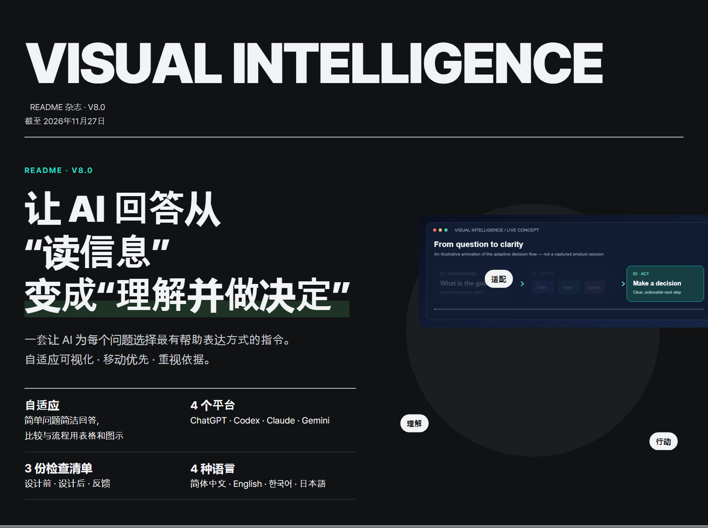
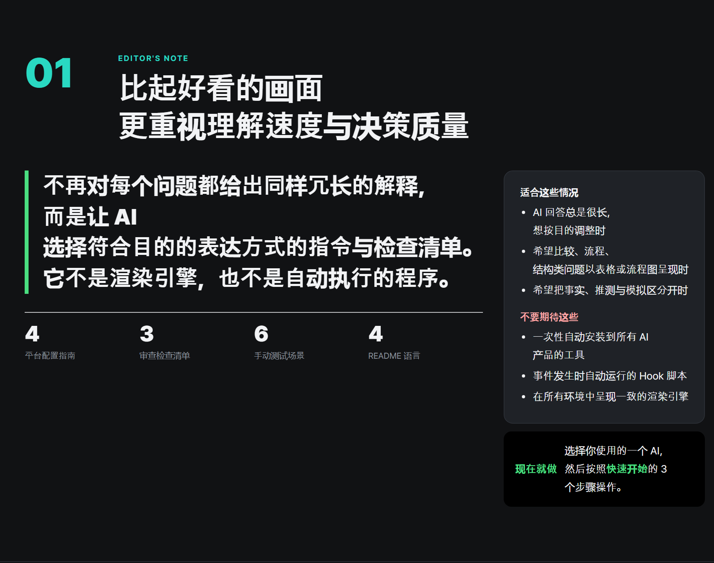
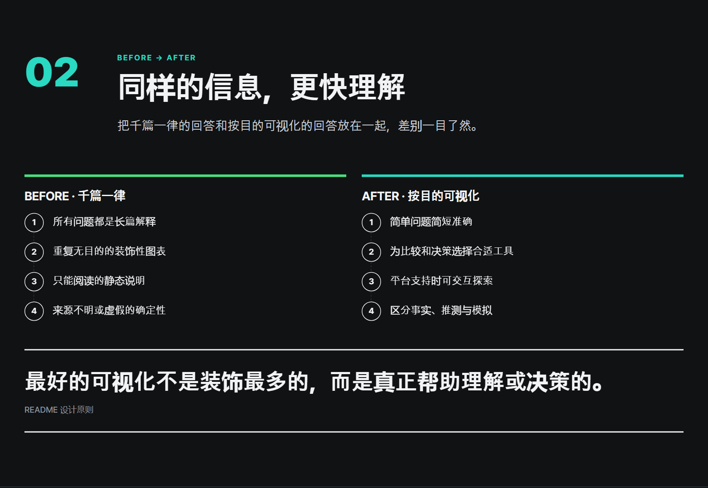
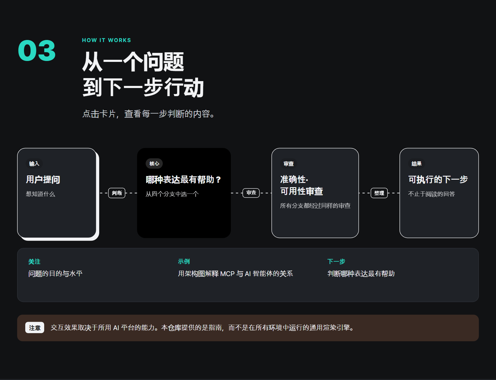
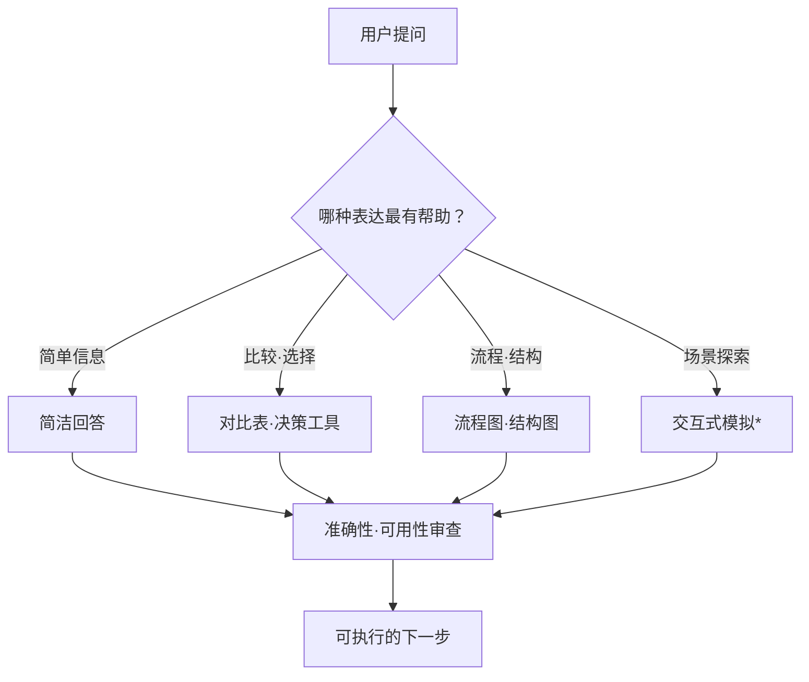
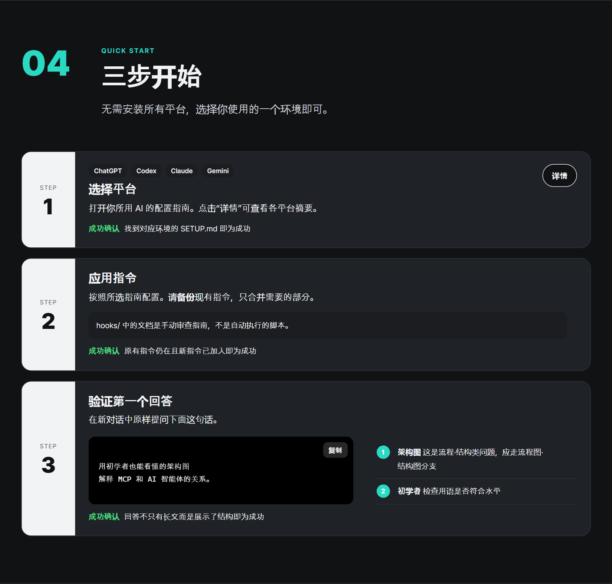
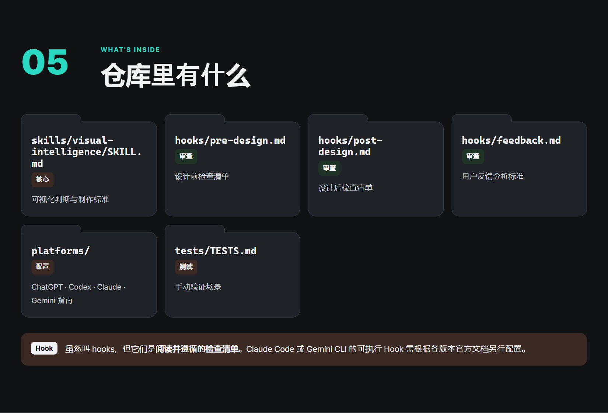
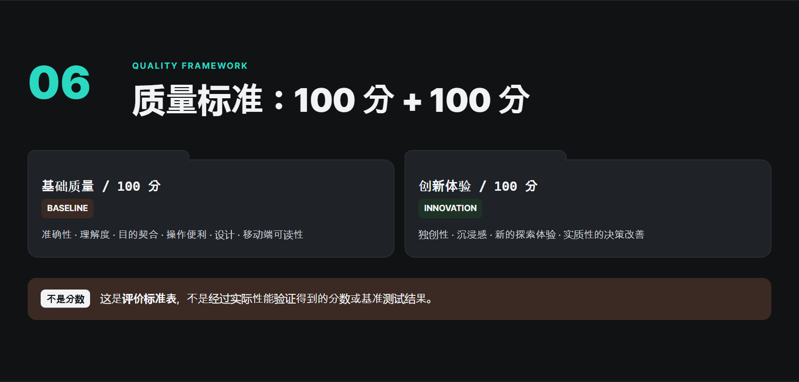
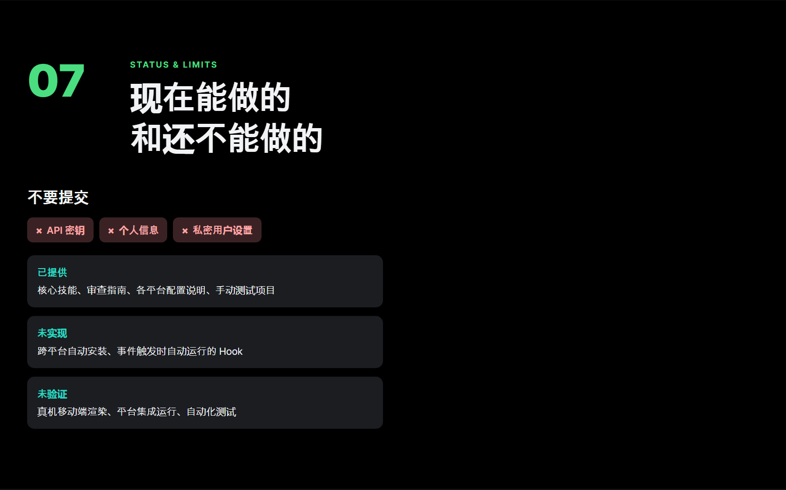
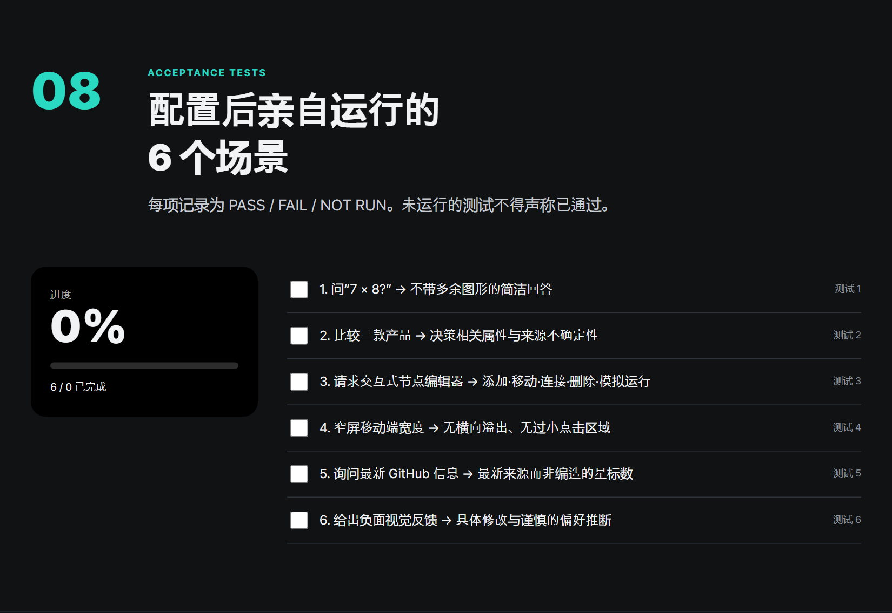

# HAEON Response OS V9 — release candidate

**AI-led minimal-touch setup:** give your AI this request:

> Read AI-SETUP.md on the v9-ai-setup branch of https://github.com/dominkang90/visual-intelligence-v8 and install and verify the skill for my environment with minimal manual steps.

[AI setup protocol](AI-SETUP.md) reuses the existing V8.1 skill. Automatic installation depends on actual host permissions; ChatGPT, Claude chat and Gemini may require a manual settings action. End-to-end platform tests remain pending. Existing V8.1 documentation and V8.0 visual examples follow.

---

<div align="center">

[한국어](README.ko.md) · [English](README.md) · [日本語](README.ja.md) · **简体中文**

<a href="https://dominkang90.github.io/visual-intelligence-v8/zh-CN/"></a>

[**▶ 以翻页杂志打开**](https://dominkang90.github.io/visual-intelligence-v8/zh-CN/) · [**三分钟入门**](#quick-start) · [**核心技能**](skills/visual-intelligence/SKILL.md) · [**测试场景**](tests/TESTS.md)

</div>

<br />







<details>
<summary>以文本（Mermaid）查看流程</summary>



</details>

<a id="quick-start"></a>



| 环境 | 配置方法 |
| :--- | :--- |
| ChatGPT | [自定义指令](platforms/chatgpt/SETUP.md) |
| Codex | [技能配置](platforms/codex/SETUP.md) |
| Claude / Claude Code | [配置指南](platforms/claude/SETUP.md) |
| Gemini / Gemini CLI | [配置指南](platforms/gemini/SETUP.md) |

**第一个验证问题**

```text
用初学者也能看懂的架构图
解释 MCP 和 AI 智能体的关系。
```



[`skills/visual-intelligence/SKILL.md`](skills/visual-intelligence/SKILL.md) 核心技能 · [`hooks/pre-design.md`](hooks/pre-design.md) 设计前检查 · [`hooks/post-design.md`](hooks/post-design.md) 设计后检查 · [`hooks/feedback.md`](hooks/feedback.md) 反馈分析 · [`platforms/`](platforms/) 各平台指南 · [`tests/TESTS.md`](tests/TESTS.md) 测试场景







<p align="right"><a href="tests/TESTS.md"><b>打开测试场景 →</b></a></p>

---

<div align="center">

**快速链接** · [核心技能](skills/visual-intelligence/SKILL.md) · [设计前检查](hooks/pre-design.md) · [设计后检查](hooks/post-design.md) · [反馈分析](hooks/feedback.md) · [ChatGPT 指令](platforms/chatgpt/GLOBAL-INSTRUCTIONS.txt) · [变更记录](CHANGELOG.md) · [MIT 许可证](LICENSE)

<sub>README 中的图片是同内容杂志页面的截图。卡片点击、复制、清单等交互请在杂志中使用。</sub>

<sub>VISUAL INTELLIGENCE V8.0 · 理解胜于装饰，行动胜于解释。</sub>

[한국어](README.ko.md) · [English](README.md) · [日本語](README.ja.md) · **简体中文**

</div>
